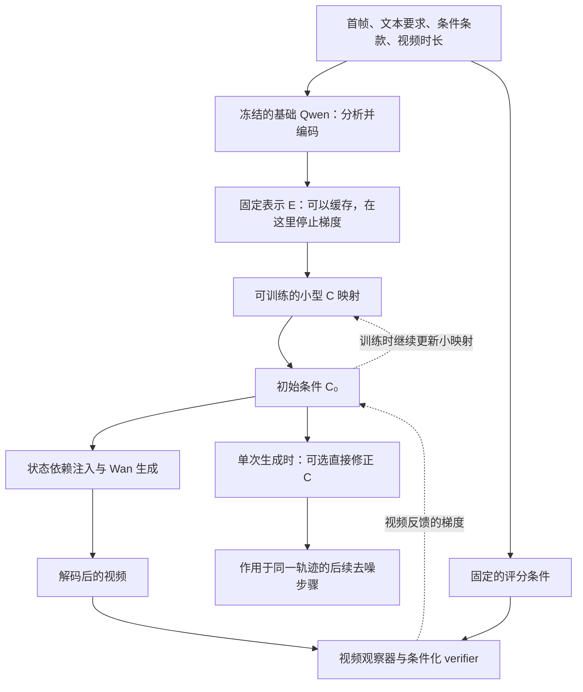

# v5.2.2-native：冻结 Qwen、直接优化 C 的设计分析

日期：2026-10-26。

本文只提出设计和分析，不代表已经修改模型、切换训练方案或启动实验。判断依据是当前代码与已经保存的实验记录；对尚未证明的效果，会明确说明。

**先回答最核心的问题：Qwen 可以完全不训练，而且我建议把它作为下一步优先验证的简化方案。**

Qwen 的职责可以限定为：根据首帧、文本要求和视频时长，提供初始场景与物理依赖的表示。后续如何把这些信息用于视频生成，由较小的 C 映射和 Wan 注入接口学习。verifier 的反馈可以直接到达 C，也可以进一步更新这个小映射，完全不需要进入 Qwen。

推荐的基本分工是：

- **冻结的 Qwen：** 提供输入理解和依赖分析，不训练任何 Qwen 参数，也不在其内部训练 soft prompt 或其他适配参数。
- **较小的 C 模块：** 把固定表示转换为 Wan 能使用的条件，负责跨样本积累经验。
- **Wan 和注入接口：** 根据 C 生成视频，并用正常的生成、过程监督学习如何使用 C。
- **verifier：** 根据实际视频提供反馈；训练时可以更新 C 模块，单次生成时可以直接修正当前 C。

这保留了“集中物理条件 C、视频反馈、状态依赖注入”三个核心要素。它不要求 Qwen 本身学会一个新的物理推理程序。

**Qwen LoRA 有可能有用，但目前不能把它说成这套系统必不可少的一部分。**

当前 LoRA 安装在 Qwen 后 12 层的注意力投影上，连续 latent 更新又复用了其中最后 4 层两次。它能够学习的是：如何重新组织图像、条款和分析中的信息，让输出的条件更适合驱动 Wan。

需要区分：Qwen 先写出的那段文字分析没有参与反向传播。因此，即使 LoRA 的参数发生了更新，也不能据此说“文字层面的物理推理已经被训练好了”。当前优化的是后续连续表示及其使用效果。[LoRA 实现](/home/liuzhirui/Project/physGen/code/v5.2.2-native/physgen_native/lora.py:54)、[条件编码实现](/home/liuzhirui/Project/physGen/code/v5.2.2-native/physgen_native/knowledge.py:176)

LoRA 本身是一种有效的参数适配方法，但原论文中的结果不能直接证明这条视频反馈链上的 Qwen LoRA 有收益。[LoRA 原论文](https://arxiv.org/abs/2106.09685)

当前项目能确认的证据范围如下：

| 已有记录 | 可以说明什么 | 还不能说明什么 |
|---|---|---|
| 本次核对时，v8 主实验保存到第 105 步，仍在 interface 阶段，没有正式 verifier 反馈记录 | Qwen LoRA 正在接受 FM、过程等阶段一目标的训练 | 不能用这次主训练判断 verifier 是否已经训练出了更好的 Qwen 表示 |
| Run66200 的三阶段短检查中，verifier 到 C 的加权梯度 RMS 约为 `4.81e-9` | 实际模型的反馈能够到达 C | 单次短检查不能证明方向有效，也不能单凭这个数断定梯度消失 |
| 联合阶段日志中的 knowledge 参数组有梯度 | Qwen LoRA 参与了优化 | 该数值混合了生成目标和反馈目标，不能单独证明 verifier 对 LoRA 的贡献 |
| 已安排的文本条件基线、关闭连续推理对照 | 可以分别检查生成侧 Qwen 条件和连续计算的贡献 | 它们不等于严格的“同样编码结构下，冻结 Qwen 与训练 Qwen LoRA”的对照 |

来源：[主训练日志](/home/liuzhirui/Project/physGen/code/v5.2.2-native/analysis/queue_20261025_causal_response/code/checkpoints/v522-native-causal-response-wisa3857_66180/metrics.jsonl)、[真实模型短检查](/home/liuzhirui/Project/physGen/code/v5.2.2-native/analysis/queue_20261025_blk_validation/verifier_gradient/result.json)。第 105 步是本次读取到的记录位置，不代表后续运行进度。

因此，我不建议先继续增加 Qwen 的推理轮数或可训练范围。更值得先回答的问题是：**固定 Qwen 已经给出的信息，C 能不能被有效使用，verifier 能不能给出有用的修正方向？**

**反传路径长确实可能影响学习，但“长”不是当前唯一的问题，也不一定表现为梯度消失。**

当前 verifier 的训练反馈大致经过：

```text
verifier → V-JEPA 视频观察器 → VAE 解码器
         → 4 步 Wan → C 映射 → 两轮 Qwen 隐藏状态更新 → Qwen LoRA
```

其中每一步都可能改变梯度的大小和方向。长链既可能缩小梯度，也可能放大梯度；最终损失还可能与 FM、过程损失对同一组参数的要求不同。只看网络层数或“梯度非零”，无法判断学习是否有效。

当前还有几个具体因素：

- C 在 Wan 多个位置被读取，梯度来自多个使用位置，并不是只沿一条串行通道穿过所有层。
- 两轮 Qwen 计算共享权重，并且改变了末层原有的使用方式。计算可微，不等于预训练模型天然会利用这种循环完成更好的物理推理。
- joint 默认有 400 次更新，verifier 每 4 次更新只对最后一个微批样本追加反馈，总共约 100 次样本级反馈。常规生成训练则覆盖约 3,200 个微批样本。覆盖范围和梯度噪声也需要考虑；这不意味着两者梯度强度简单相差 32 倍。
- VAE、观察器和生成器即使冻结参数，为了得到 C 的梯度，仍然需要计算对输入的导数。冻结权重与省掉反向传播不是一回事。

已有研究确实发现，扩散采样链的完整奖励反传可能出现梯度放大，截短反传可以改善某些任务的优化。但这支持研究具体的反传范围，并不证明任意截断都适合当前视频任务。[DRaFT 原论文](https://arxiv.org/html/2309.17400v2)

当前代码的离散伴随和激活重算主要解决显存占用，保持所定义目标的导数；它们不会自动修复错误的监督目标或无效的反馈方向。

**建议的新流程，让 Qwen 的计算在生成训练之前结束。**



这个方案中的“固定表示 E”只来自合法的初始输入。参考视频的未来帧仍然只能用于训练目标，不能进入普通生成的条件。

实现职责可以压缩成两行：

```text
E = 冻结 Qwen 对输入的编码，输出后停止梯度
C₀ = 小型映射 P 对 E 的转换
```

第一版可以直接使用已有 C 模块中的归一化、线性映射和来源调制，不先增加一个新的大 Transformer。现有代码已经将这部分独立成 `KnowledgeCondition`，它与 Qwen 参数是分开的。[C 映射实现](/home/liuzhirui/Project/physGen/code/v5.2.2-native/physgen_native/conditioning.py:26)

Qwen 原有的两轮末层复用，在这个简化版本中不再承担可训练的连续推理。若保留显式文字分析，它仍由冻结 Qwen 生成；若需要根据视频反馈继续修订条件，则通过后面的 C 优化完成。两者是不同的计算机制，文档和实验中应明确区分。

固定 Qwen 的代价是：下游只能使用它已经表达出来的信息。如果关键条件没有被编码出来，小映射不能凭空补齐。因此，这个方案需要检查输入条件的区分能力，但没有必要预先假定“只有训练 Qwen 才能解决”。

**真正节省 Qwen 成本，需要同时做到冻结、停止梯度和复用固定结果。**

仅把 Qwen 的学习率设成零，并不足以得到最干净的实现。推荐边界是：Qwen 使用固定基础权重，整个输入编码在无梯度模式下完成，输出 E 后不再保留 Qwen 的训练计算图。

对于已有训练样本，可以提前保存 E。训练时加载 E，再训练小映射和视频生成部分。这里应该缓存的是映射之前的固定表示，不能把仍在学习的小映射输出 C 当成永久固定结果。

缓存需要区分首帧、文本、条款、时长以及编码配置。文本丢弃、条款丢弃、替换文本等情况，如果改变了 Qwen 的输入，就需要对应的固定编码。新缓存是现有样本的派生计算，不修改原有 `wisa_4000` 缓存，也不使用未来视频补充普通推理条件。

新输入推理时，Qwen 仍需要完成一次分析与编码；但不需要在每个 Wan 去噪步骤重新运行。训练阶段若固定编码已经准备好，Qwen 也不必一直驻留在训练 GPU 上。

这里还有一个容易忽略的问题：**不要把需要学习的 latent 或 soft prompt 放在 Qwen 输入端，再要求损失穿过 Qwen。** 那样虽然 Qwen 权重冻结了，反向计算仍会经过 Qwen。要实现本方案的成本目标，可训练部分应放在 Qwen 输出之后。

这个改动可以去掉 Qwen 的训练激活、反向重算和适配参数优化成本。至于总耗时和峰值显存能降低多少，需要同一硬件上的比较；不能只凭模型大小承诺比例。Wan、VAE 和视频观察器的可微计算仍然存在。

**“直接优化 latent”最适合从最终的 C 开始，而不是把所有叫 latent 的量混在一起。**

| 优化位置 | 梯度还需要经过什么 | 对当前目标的意义 |
|---|---|---|
| 最终 C | 视频观察器、VAE、所选 Wan 计算 | 最直接地修正物理条件，完全不需要反传进 Qwen |
| 原设计中的最终工作状态 R₂ | 上述路径，再经过 C 映射 | 也可以不进入 Qwen，但更新空间和坐标不同 |
| 原设计中的初始工作状态 R₀ | 上述路径，再经过两轮 Qwen 层 | 仍然保留了用户担心的 Qwen 反向成本 |
| 视频 latent z | 从评分返回视频解码路径即可，取决于优化位置 | 改的是视频本身，不等于改善 C，也不会自动训练出更好的条件表示 |

本文后面所说的直接优化 latent，默认指最终 C。

**直接优化 C 的具体做法，是固定模型权重，只改变当前样本的条件向量。**

一次修正可以按下面的顺序进行：

1. 冻结 Qwen 产生 E，小映射产生初始条件 C₀。
2. 将 C₀ 复制成一个独立的、可求导的 C。它与 Qwen、小映射的训练图断开。
3. 固定 Wan、注入接口、VAE、观察器和 verifier 的权重，用这个 C 得到视频估计。
4. verifier 根据该视频估计和原始输入条件计算损失。
5. 只计算损失对 C 的梯度，沿降低损失的方向对 C 做小幅更新。
6. 把修正后的 C 用于后续生成，或者在训练诊断中检查它的实际效果。

这里“固定网络权重”并不意味着把整个视频计算放进无梯度模式。网络仍要把视频反馈传回 C，只是不更新它们自己的参数。

为了避免 C 只顾提高评分而远离原始条件，可以使用这样的目标：

\[
J(C)=L_{\mathrm{verifier}}(\widehat V(C),q_x)
     +\lambda\frac{\|C-C_0\|_F^2}{d\,s^2}.
\]

其中，`q_x` 是由原始输入得到的固定评分条件，`d` 是 C 的元素数量，`s²` 是初始 C 的均方尺度；实际计算需要给尺度设置一个非零下限。后一项的意思就是“允许修正，但不要无约束地偏离原始条件”。它只是约束更新范围，不是物理正确性的保证。

几个设计细节尤其重要：

- 评分条件必须固定。不能一边优化生成 C，一边把同一个可变 C 当作 verifier 判断对错的依据，否则可能通过改变判题条件来提高分数。
- 更新幅度要和 C 的尺度匹配，并检查实际相对变化。当前 `relative_rms` 更新已经处理了向量维度与尺度，但没有因此证明物理收益。
- 不把任意小梯度都强行放大成 C 的 10% 或 50% 扰动。历史实验已经表明，大幅更新可能明显破坏结果。
- 如设置偏离上限，应约束累计偏离 C₀ 的程度，而不只是每一步的变化。
- 直接更新 C 后，必须真的保留并使用新 C。只做 `detach` 或只算出梯度，然后重新编码覆盖它，不会产生期望的修正。

当前代码已经有一种单轨迹实现：在指定去噪位置，用当前步骤得到的速度形成干净视频估计，求 C 的梯度，然后让新 C 作用于后续步骤。它不重启视频、不进行多个候选的选择，且默认关闭。现有代码能作为实现依据，但其质量收益还没有被证明。[在线 C 更新实现](/home/liuzhirui/Project/physGen/code/v5.2.2-native/physgen_native/feedback_sampling.py:52)

**让反馈“短一些”，需要明确究竟省掉哪一段。**

| 做法 | 可以省掉什么 | 需要接受的限制 |
|---|---|---|
| 保持四步条件补全，只反传到 C 或小映射 | 全部 Qwen 反向计算 | Wan、VAE、观察器仍需对 C 求导；这是最清楚的第一步简化 |
| 对当前一步得到的干净视频估计评分，只更新 C | 多步 Wan 展开的反向计算，以及 Qwen 反向计算 | 优化的是当前视频估计，不能称为最终 50 步视频的精确梯度 |
| 训练一个直接输入 C 的评分代理 | 使用代理时，可以绕过真实视频生成和观察的导数 | 需要额外训练并验证代理，可能预测错更新方向，不能自动替代视频 verifier |

第二种做法中，一个 Wan 前向仍然处理完整时空视频状态。**去噪步骤数和视频帧数是两回事：减少反传的去噪步骤，不必减少 81 帧的时间覆盖。** 但高噪声阶段的干净视频估计可能不准确，verifier 是否适用于这些估计，需要专门验证。

如果 verifier 只看视频，那么它对 C 的真实反馈就必须经过“C 如何改变视频”这条计算关系。不能在完全绕过生成器的同时，还把所得梯度称为原视频目标对 C 的精确梯度。

直接评分代理可以作为后续研究，但不建议现在优先加入。相同 C 在不同噪声、去噪阶段和生成器状态下会产生不同视频；只看 C 的评分器最多学习某种平均效果。若要判断当前轨迹，还要考虑当前状态等信息，并用实际生成中的 C 扰动训练、验证它的方向。仅仅把分数拟合得接近，并不足以证明其梯度可靠。

**直接修正 C 和学会产生更好的 C，是两件需要分别安排的事。**

直接优化 C，改善的是当前输入、当前轨迹的条件。下一个样本重新编码时，这次修正不会自动变成模型的长期能力。

因此，推荐把长期学习与单次修正分开：

- **长期学习：** E 固定，让 FM、过程损失和经过验证的 verifier 反馈训练小映射 P。梯度到 P 就结束。Wan 和注入接口仍按各自目标学习，保留原来的梯度归属约束。
- **单次修正：** 固定全部参数，只在当前生成中更新 C。它负责根据当前生成状态作小幅调整，不声称自动改善所有后续样本。

这两部分都不需要训练 Qwen。第一版也不必新增“先多次优化 C，再训练网络拟合 C”的独立阶段，避免增加重复生成成本。

如果后续发现优化后的 C 在多个噪声种子上都稳定有效，可以再考虑用这些 C 作为小映射的训练目标。需要注意：某个噪声种子下特别有效的 C，可能包含只适合该轨迹的修正，不应该直接当作该场景唯一正确的通用条件。

还有一个数学上的限制：如果只对 C 做一步梯度更新，然后立刻用平方误差拟合这一步得到的目标，在相同度量和适当缩放下，一阶梯度可以与原来的端到端更新等价。把流程写成两阶段，并不会自动得到更好的学习信号。收益必须来自更可靠的目标、更合适的更新范围，或目标在多个样本上的复用。

**过去效果不理想，已有记录首先指向监督和条件使用的问题，不能全部归因于 Qwen 太大。**

下面只列出能够从保存记录中定位的问题，并注明解释边界。

| 问题 | 已有证据 | 对设计的含义 |
|---|---|---|
| 旧辅助未来预测可以接近静态，损失却几乎不变 | v5.2.1-mechanism 的受控检查中，把未来预测压平成常量，过程损失只增加约 0.51%；关闭 M 读取，未来 MSE 只增加约 0.049% | 当时的目标对时序退化和机制依赖不够敏感。增加推理模块，并不能修复这种目标 |
| C 有数值作用，但具体内容未被可靠使用 | 旧内容 readout 训练后，替换成其他样本 C，留出集 FM 误差仅变化约 0.0004%–0.0141% | 与“模块更像通用适配器、条件内容作用很弱”的解释相容；不能仅凭关闭 C 变差就宣布物理条件有效 |
| verifier 学到了不合适的判断依据 | 旧真实／生成来源分类 head 的三个种子，在相同 8 个开发场景上都更偏好全冻结视频 | 区分真实与生成来源，不等于判断过程是否合理；把这种反馈传得更深可能加强错误方向 |
| 条件对比目标可以通过让错误分支更差来下降 | 旧目标比较正确、替换条件的过程误差差值 | 损失下降不要求正确视频改善；v8 已移除生成侧这个目标，但有效依赖仍需验证 |
| 梯度计算范围与实际改动范围不一致 | 旧实验只对末 12 步求导，却在重新采样时把新 C 用于全部 50 步 | 被忽略的前缀也变了。不能把这种更新当成所测试全程目标的精确下降方向 |
| 更新尺度存在问题 | 旧大幅 C 扰动效果不稳定；后来在线更新又出现相对变化约 `1e-7`，并发现 CLI 覆盖了已保存的 `relative_rms` 配置 | “梯度算出来了”与“C 在有效且合适的范围内改变了”必须分别检查 |
| 单一外部评测对时间错误不敏感 | 一组真实视频及其全冻结版本的 VideoPhy2 PC 均值都为 4.5 | 单个总分不能独立证明长程一致性，必须检查实际过程、后段表现和条件选择性 |

来源：[旧机制诊断](/home/liuzhirui/Project/physGen/code/v5.2.1-mechanism/analysis/horizon_step100_20261022/summary.json)、[条件使用与评分诊断](/home/liuzhirui/Project/physGen/code/v5.2.2-native/analysis/evidence_20261024.json)、[梯度范围与历史对照记录](/home/liuzhirui/Project/physGen/code/v5.2.2-native/README.md:178)、[v8 修订记录](/home/liuzhirui/Project/physGen/code/v5.2.2-native/analysis/causal_response_20261025/implementation.json)。这些证据来自不同版本，不能把旧版的全部问题直接当作 v8 已经测得的结果。

旧 C 优化对照还给出一个明确提醒：在 5 个场景、2 个噪声种子的末 12 步梯度实验中，10% C RMS 的更新平均收益约 0.52%，等幅随机方向约 0.60%，梯度方向只在 4/10 个组合上更好。完整 50 步的部分实验只有 2 个场景、2 个种子，平均收益约为 -30%，同样没有证明长链更有效。

这些是使用参考未来的训练能力对照，不是普通推理时学习型 verifier 的收益。它们否定的是“只要直接优化 C 或反传更完整，就一定有效”的判断；不能外推为 C 永远无法优化。[12 步统计](/home/liuzhirui/Project/physGen/code/v5.2.2-native/analysis/feedback_review_20261025/oracle_k12_summary.json)、[50 步部分统计](/home/liuzhirui/Project/physGen/code/v5.2.2-native/analysis/feedback_review_20261025/oracle_k50_partial_summary.json)

旧长链检查中也出现过很大的梯度：两次实际反馈更新的裁剪前主梯度范数约为 5,811 和 20,066。因此，历史问题并不只是“梯度传远了变小”，还包括放大、更新过大，以及下降方向与实际应用范围不对应。

**运行失败还包含独立的工程问题，需要与模型是否有效分开判断。**

| 失败记录 | 已确认的事实 | 根因边界 |
|---|---|---|
| Run66135 启动失败 | 任务全局的 `PYTHONNOUSERSITE=1` 干扰了容器启动 | 属于启动配置错误，不是模型推理或物理监督失败 |
| Run66140 首次训练反传 OOM | VAE 反传时进程占用约 94.76 GiB，GPU 容量约 94.97 GiB | 有明确的 CUDA 显存不足证据；完整分支及 VAE 内部激活的保存、重算粒度需要处理 |
| 后续 VAE 重算修订 | 仅做时间块重算，反传时仍可能一次重建多层高分辨率激活；按原生残差块重算后，真实 VAE 反传及完整模型微批得到执行验证 | 这是内存组织问题；冻结 Qwen 可以减轻占用，但不能自动消除 VAE 反传开销 |
| 多个任务以 SIGKILL／137 结束 | 没有对应的 Python CUDA OOM 异常，部分记录的 cgroup OOM 计数为零；旧 v5.2 推理在同一分配上也复现了 SIGKILL | 不能认定全部由新模型、Qwen LoRA 或显存不足引起；具体信号来源尚未确认 |
| 一次外层脚本显示 247 | 子进程实际返回 -9，外层转译了退出码 | 会干扰故障判断，但不是模型学习失败的解释 |

来源：[运行失败对照](/home/liuzhirui/Project/physGen/code/v5.2.2-native/analysis/submission_failure_review_20261025/comparison.json)、[解码反传修订](/home/liuzhirui/Project/physGen/code/v5.2.2-native/analysis/queue_20261025_decoder_blocks/implementation.json)、[旧版本独立复现](/home/liuzhirui/Project/physGen/code/v5.2.2-native/analysis/legacy_v52_controls_20261025/comparison.json)。

从这些记录看，我的设计判断是：之前在“C 的具体内容是否被使用、反馈方向是否可信”尚未建立时，同时扩大了推理结构、评分目标和反传范围，导致成本增加，也更难定位每个改动的价值。这个判断不意味着所有历史修改都没有必要；显存修复、梯度范围修复和无效监督修复，各自解决的是不同问题。

**冻结 Qwen 之后，验证顺序应该更短、更明确。**

建议按下面的顺序推进；这里只描述待做验证，不启动任务。

1. **先检查 C 是否有内容相关的作用。** 在相同首帧和噪声下，比较正确 C、关闭 C、替换条件得到的 C。既看输出是否变化，也看变化是否符合被改变的条件。只有“关掉模块变差”还不够。
2. **再检查 verifier 给 C 的方向是否有用。** 固定模型，比较原始 C、小幅梯度修正、等幅随机修正。计算梯度时使用的起点、条件和修正作用范围必须对应。既检查所定义目标的局部变化，也看完整视频的条件符合程度、中后段过程和视觉质量。
3. **确认直接修正有用之后，再判断小映射能否学到这种规律。** 使用冻结 Qwen 的方案训练小映射，检查新样本与不同噪声种子。不要仅在一个已经适应 Qwen LoRA 输出的旧接口上关掉 LoRA，就把结果当作冻结方案训练后的上限。
4. **最后比较成本。** 在同一硬件、相同帧数、训练目标和微批设置下，记录耗时与峰值显存。先把省掉 Qwen 反向的收益测清楚，再决定是否需要把四步反馈改成一步局部估计。

判断分支也应提前明确：

- 如果小幅直接修正 C 都无法稳定优于随机方向，先检查 verifier、C 的作用强度和更新范围；继续增加 Qwen 学习能力没有充分依据。
- 如果直接修正 C 有用，但训练小映射没有收益，才进一步检查跨样本目标是否一致、梯度是否被其他损失影响，以及小映射的表达能力。
- 如果固定 Qwen 加小映射已经有效，就没有必要为了保留原设计而继续训练 Qwen。

我建议先采用的版本是：**冻结基础 Qwen、缓存合法初始表示、训练现有小型 C 映射和生成接口、保留完整视频过程监督与条件化 verifier，并把直接 C 修正作为独立验证的可选能力。** 是否恢复 Qwen LoRA，应由它在相同条件下带来的额外收益决定，而不是作为整个方法成立的前提。
