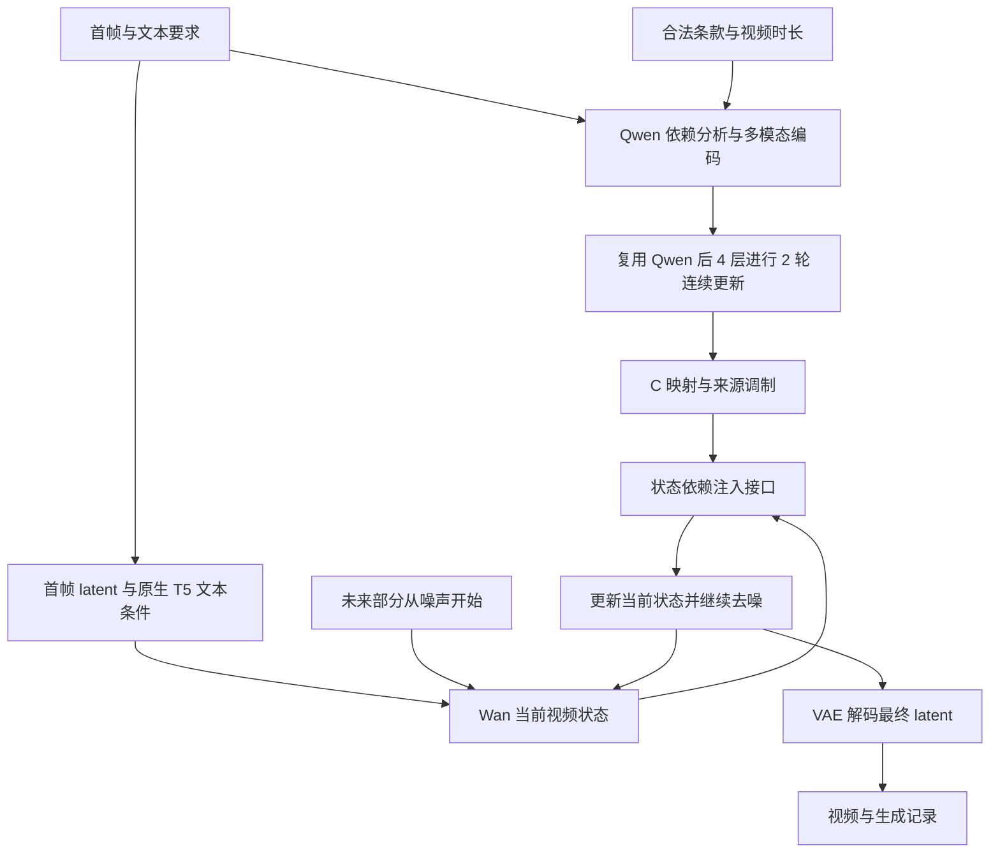
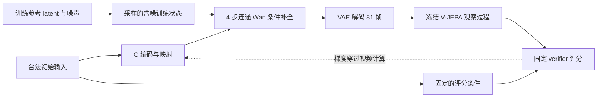

# V5.2.2 Native pipeline 介绍

核对日期：2026-10-26。当前介绍对应 `v522_native_causal_response_v8`，配置为 [native_causal_response_wisa3857.yaml](../configs/native_causal_response_wisa3857.yaml)。[打开交互讲解页](native-pipeline-explainer.html)。

**这条 pipeline 要做的事，是让视频里的变化符合输入条件，并在后续画面中持续成立。** Qwen 把首帧和要求整理成条件表示 C。Wan 读取 C，逐步生成视频。训练时，过程监督和 verifier 根据实际生成结果，帮助模型学习如何构造和使用 C。

阅读顺序：先看“一分钟理解”和流程图；需要理解训练，再看三个阶段；需要修改代码，再看文件索引。文字采用短句、固定术语和分层解释，借鉴你提供的简化表达思路，不声称符合 ASD-STE100 标准。

## 一分钟理解

可以把系统分成三个职责：

| 职责 | 模块 | 它实际做什么 |
|---|---|---|
| 整理条件 | Qwen 与 C 映射 | 读取首帧、文本、条款和时长，形成 Wan 可以使用的条件向量 |
| 生成过程 | Wan 与注入接口 | 根据当前视频状态，选择 C 中适用的信息，更新视频表示 |
| 提供反馈 | 过程损失与 verifier | 检查生成结果中的变化，训练条件表示和生成路径 |

**Native 指的是：演化状态保留在 Wan 内部。** 系统没有另建一个 M 组织器、S 未来预测器或独立未来状态展开。C 提供条件，Wan 承担视频演化。

C 可以理解为“供生成器读取的条件笔记”。但它实际是一组连续向量，不是人工编写的规则表，也不是已经排好每帧内容的轨迹。

## 普通推理怎样生成一段视频



图中回环表示 **50 次去噪更新**。每次更新处理整段视频的压缩表示，并不是每次生成一帧。

1. **准备输入。** 输入包含首帧、文本要求、从首帧和文本获得的条款、时间位置。Wan 还保留原生 T5 文本条件路径。
2. **整理依赖。** Qwen 先写出初始观察、相互作用、持续条件和条件变化后的响应分析。分析只使用合法初始输入，并考虑视频时长。
3. **形成 C。** Qwen 对这些内容编码，再复用原生后 4 层做 2 轮连续隐藏状态更新。映射模块把结果转换成 Wan 使用的 C。
4. **反复读取 C。** Wan 每经过 3 个 Transformer block，注入接口读取一次 C。读取结果与当前位置的状态相乘，经门控后加入未来部分的状态。首帧位置保持已知条件。
5. **输出视频。** 默认用 Euler 更新和 CFG，完成 50 步去噪。VAE 解码后输出 MP4，同时保存种子、版本、采样参数和依赖分析等 JSON 记录。

CFG 在同一去噪步骤中使用正、负条件计算。它仍然是一条视频轨迹，不是生成两个候选视频再挑选。默认推理不加载视频观察器和 verifier。

实现：[条件编码](../physgen_native/knowledge.py)、[连续更新](../physgen_native/latent_reasoning.py)、[注入接口](../physgen_native/conditioning.py)、[Wan 遍历](../physgen_native/generator.py)、[采样](../physgen_native/system.py)。

## 用一个例子串起来

假设首帧中有容器和有色液体，文本要求“液体继续混合”。下面只是帮助理解职责的例子，不是实测生成结果。

| 环节 | 这个例子中需要表达或检查的内容 |
|---|---|
| 初始条件 | 首帧能看见什么，文字要求发生什么，片段持续多久 |
| Qwen 分析 | 哪些接触和持续作用与混合相关；哪些信息仍然未知 |
| C | 将这些依赖压缩成生成器可以读取的连续表示 |
| Wan | 在自己的时空状态中生成液体形态与颜色分布的变化 |
| 过程监督 | 生成变化是否接近参考过程；后半段是否仍有对应变化 |
| verifier | 候选视频呈现的过程是否与初始条件和要求相匹配 |

同样的分工也适用于气体扩散、波浪、形变、出现和消失，以及刚体运动。系统的对象是一般可见过程，不能只用“物体移动了多远”解释。

## C 是怎样形成并起作用的

**先分清两种推理。** Qwen 生成的文字分析在无梯度模式下完成。后续编码和两轮连续隐藏状态更新可以接受生成损失的梯度。训练 Qwen LoRA，不等于已经训练好了那段离散文字的推理质量。

当前 C 最多有 128 个 token。Qwen 内容宽度为 4096，映射后的 C 宽度为 3072。v8 允许工作 token 之间相互读取，较早的 token 也能读取较晚 token 的更新结果。初始多模态记忆仍保持原生因果掩码，不能反向读取工作 token。

**C 给出条件，当前状态决定怎样使用条件。** 同一组 C，会被不同视频时间、空间位置、网络深度和去噪阶段的状态读取。接口在每个注入位置重新加入视频时间信息。

用最少的符号表示：

```text
H = Wan 当前的时空隐藏状态
m = 当前状态 H 从 C 中读出的信息
a = 预测的连续局部可见变化强度
σ = 当前噪声水平

ΔH = gate(H, σ, a) × W_o[SiLU(W_h Norm(H)) ⊙ W_c m]
H_new = H + condition_strength × ΔH
```

这里 `⊙` 表示逐元素相乘。它让 C 选择“当前状态怎样更新”。`a` 进入软门控；低强度不会直接关闭生成，也不会把首帧复制到所有未来帧。

`a` 来自 RGB 可见变化的弱监督，不能解释为物理速度。FM 中的 velocity 则是去噪路径的导数，也不是物体在视频中的运动速度。

实现：[KnowledgeCondition](../physgen_native/conditioning.py)、[StateConditionedSite 与 NativeInterface](../physgen_native/conditioning.py)、[Qwen LoRA](../physgen_native/lora.py)。

## 训练分三个阶段

配置中有 3,857 条既有缓存，划分为 3,666 条训练样本、191 条验证样本。每段视频为 81 帧，对应的 latent 形状为 `[48, 21, 30, 52]`，不含 batch 维。21 是压缩后的时间位置数。

下面的步数是优化器更新次数。每次更新累积 8 个微批，三个阶段预算合计 1,260 次更新。

| 阶段 | 更新预算 | 学习任务 | 损失及权重 |
|---|---:|---|---|
| interface | 400 | 让条件和注入接口能够参与生成 | FM × 1；过程 × 0.1；强度 × 0.1 |
| calibration | 460 | 训练 verifier 判断条件与过程的对应关系 | 过程排序 × 1；条件匹配 × 1 |
| joint | 400 | 继续训练生成，并让 verifier 反馈打磨 C | FM × 1；过程 × 0.1；verifier × 0.05 |

联合阶段的 verifier 项按单独调度追加：每 4 次更新一次，使用该次更新的最后一个微批样本。它不是每个微批都执行。

### 哪些参数在学习

| 参数 | interface | calibration | joint 的 FM 和过程 | joint 的 verifier 反馈 |
|---|---|---|---|---|
| Qwen 知识与连续推理 LoRA | 更新 | 固定 | 更新 | 更新 |
| C 映射 | 更新 | 固定 | 更新 | 更新 |
| 注入注意力与状态算子 | 更新 | 固定 | 更新 | 传递对 C 的导数，不更新参数 |
| 连续强度预测头 | 更新 | 固定 | 固定参数，保留输入导数 | 固定参数，保留输入导数 |
| Wan LoRA | 固定 | 固定 | 更新 | 传递对 C 的导数，不更新参数 |
| verifier 评分头 | 不训练 | 更新 | 固定 | 固定参数，保留输入导数 |
| 基础 Qwen、基础 Wan、VAE、V-JEPA | 固定 | 固定 | 固定 | 固定 |

“固定参数”不等于“切断导数”。反馈穿过 Wan、VAE 和观察器，才能知道 C 怎样改变视频。联合阶段专门限制 verifier 项的参数更新对象，让它更新 C 映射和 Qwen LoRA。

实现：[阶段与目标校验](../physgen_native/config.py)、[训练职责](../physgen_native/operator_training.py)、[微批与反馈调度](../train/train.py)。

### FM 和过程监督各管什么

常规生成训练先用参考 latent 和随机噪声组成 `z_σ`。Wan 预测 FM 导数，再据此形成干净视频估计。FM 目标帮助模型学习去噪；过程目标检查解码后的视频怎样变化。

过程目标使用全部 81 帧，在 1、2、4、8、16、32、64 帧跨度上比较 RGB 的有符号差分。它保留“增加还是减少”的方向信息。每个时间对单独归一化，避免前段的大变化压低后段的贡献。当前配置没有额外的状态重建项或感知过程损失项。

v8 的常规生成损失只计算正确条件这一条分支。对于未触发整体文本丢弃的微批，另以 25% 概率移除 Wan 原生 T5 文本，让 C 承担更多条件作用。这个操作不删除 C 的 caption；条款仍受独立的 10% requirements dropout 控制。整体文本丢弃概率也是 10%。

实现：[operator_forward](../physgen_native/operator_training.py)、[sequence_error](../physgen_native/sequence.py)。

## verifier 怎样提供反馈

### 先让 verifier 学会比较

校准阶段固定生成路径，用同一样本构造三种视频：参考视频、模型四步补全的视频、从某个时间起保持画面的视频。冻结的 V-JEPA 观察器用相同的全上下文方式提取特征。

评分头学习两件事：一是比较同场景中过程保留得怎样；二是检查这种过程差异是否与条件有关。条件匹配同时比较正确条件和替换文本条件，使用交叉差分，减少仅靠静态图文匹配得分的捷径。

校准标签取自候选相对参考的过程差异。保持画面不自动等于物理错误：如果参考本来变化很小，标签也应反映这一点。替换文字也不等于拥有真实的反事实未来标签。

v8 的候选证据先计算 `tanh(f_t − f_0)`，再减去同一时间对的零响应读出。这消除了时间恒定的加性特征偏移，但不保证所有静态 RGB 视频都会产生恒定特征。verifier 的分数也不是物理正确率。

### 再把反馈传回 C



反馈从 `σ ∈ [0.55, 0.9]` 的训练状态开始，经过完整的 4 步条件补全。四步都参与求导，反馈最终训练 C 映射与 Qwen LoRA。训练参考未来用于构造这个训练任务，不会成为普通推理的输入。

VAE 解码完整 81 帧；观察器实际读取覆盖首尾的 **21 个双帧位置**，拼成同一个上下文输入。具体是 `[0,0]、[3,4]、[7,8] … [79,80]`。这与 RGB 过程损失覆盖每一帧不同。

四步补全不使用 CFG。它优化的是这个短补全任务，不能称为“50 步自由生成最终视频的精确梯度”。离散伴随和重算帮助控制显存，不能替代对反馈方向有效性的验证。

实现：[校准与 feedback_losses](../physgen_native/operator_training.py)、[视频观察器](../physgen_native/process_encoder.py)、[评分头](../physgen_native/conditional_verifier.py)、[离散伴随](../physgen_native/adjoint.py)。

## 三种计算不要混在一起

| 比较项 | 普通推理 | 训练中的 verifier 反馈 | 可选在线 C 修正 |
|---|---|---|---|
| 起点 | 首帧固定，未来部分从噪声开始 | 参考 latent 与噪声混合的训练状态 | 正在执行的普通推理轨迹 |
| 所用视频估计 | 50 步后的视频 | 4 步补全后的视频 | 当前步骤的干净视频估计 |
| 是否使用参考未来 | 否 | 是，构造训练起点 | 否 |
| verifier | 默认不加载 | 固定评分头提供梯度 | 固定评分头提供局部梯度 |
| 改变什么 | 当前视频 latent | C 映射和 Qwen LoRA 参数 | 当前样本的正条件 C |
| 生效范围 | 当前生成 | 后续样本可复用训练参数 | 同一轨迹的后续去噪步骤 |

在线修正默认关闭。启用 `--refine-c` 后，在指定噪声位置计算一次局部反馈，再用新 C 继续后续步骤。模型权重固定，负条件保持固定；当前步骤已经算出的速度继续使用。它不重启视频，也不从多条候选轨迹中择优。

v8 保存的在线更新度量为 `relative_rms`，阈值为 0.85、0.65，步长参数为 0.1。**0.1 不代表每次固定改变 C 的 10%。** 实际改变量仍取决于梯度。该局部导数也不等于最终完整视频的导数。

实现：[feedback_sampling.py](../physgen_native/feedback_sampling.py)、[推理入口](../inference/infer_heldout.py)。

## 哪些数据可以进入生成条件

| 数据 | C 或普通生成是否使用 | 其他用途 |
|---|---|---|
| 首帧、caption | 使用 | 同时建立固定的评分条件 |
| 仅由首帧与 caption 得到的条款 | 使用 | 缓存须声明 `caption_and_first_image` |
| 视频时间位置、时长、有效区域 | 使用 | 定义时间跨度和有效监督区域 |
| 参考视频的未来 latent 或 RGB | 不作为普通生成条件 | 训练 FM、过程损失和四步补全 |
| 参考未来的 JEPA 特征、可见变化目标 | 不作为普通生成条件 | 训练侧证据或监督 |
| 生成视频的观察特征 | 默认不进入 C 编码 | verifier 反馈；可选在线修正使用其导数 |

推理入口通过 `VideoDataset(..., targets=False)` 返回合法条件。实现仍会读取现有 VAE 缓存文件，但返回的条件不包含未来 latent。不要把“文件中存有未来数据”和“模型把未来作为条件”混为一谈。

实现：[数据加载与输入范围检查](../physgen_native/data.py)、[conditions](../physgen_native/system.py)。

## 怎样判断这条 pipeline 是否有效

现有 2026-10-25 记录确认了 v8 三阶段真实微批可以执行，并且 verifier 的反馈能够到达 C。[三阶段检查记录](../archive/20261027_cleanup/analysis/queue_20261025_blk_validation/verifier_gradient/result.json) 和 [v8 实现记录](../archive/20261027_cleanup/analysis/causal_response_20261025/implementation.json) 均未把这写成物理质量已经改善。

判断效果需要回答三个问题：

1. **C 的具体内容有用吗？** 固定首帧和噪声，比较正确 C、关闭 C、替换条件后的 C。既看视频是否改变，也看改变是否符合条件。
2. **反馈方向有用吗？** 比较原始 C、梯度修正、等幅随机修正。不能只凭梯度非零或分数上升宣布成功。
3. **完整过程更好吗？** 检查中后段过程、材料与属性连续性、视觉质量，并在多个留出场景和种子上重复。单一外部评测分数不足以回答这些问题。

这些是评估标准，不是本说明已完成的新实验。运行进度应查看对应实验自己的日志；本说明不把历史 README 的“运行中”当成实时集群状态。

## 当前版本和设计建议的边界

| 内容 | 在本说明中的地位 |
|---|---|
| v8 联合工作 token 注意力、正条件单分支、响应式 verifier | 当前介绍的实现 |
| v7 的生成侧正确与替换条件对比损失 | 旧配方；不能混入 v8 的 3／2／3 项目标 |
| 完全冻结 Qwen、缓存固定表示、主要训练小型 C 映射 | [2026-10-26 设计建议](../archive/20261027_cleanup/analysis/冻结Qwen与直接优化C_设计分析_20261026.md)，未作为当前实现讲解 |

**实际推理以 checkpoint 内保存的配置为准。** `infer_heldout.py` 先读取断点配置，再应用显式推理参数。编辑工作区 YAML 不会把旧断点自动升级为 v8。

## 文件入口

| 想了解什么 | 文件与定位 |
|---|---|
| 当前参数与阶段预算 | [configs/native_causal_response_wisa3857.yaml](../configs/native_causal_response_wisa3857.yaml) |
| 单卡训练任务配置 | [archive/20261027_cleanup/train/native_causal_response_1x80g.yaml](../archive/20261027_cleanup/train/native_causal_response_1x80g.yaml) |
| 训练、保存与验证 | [train/train.py](../train/train.py)，`train`、`validate`、`export_video` |
| 输入数据 | [physgen_native/data.py](../physgen_native/data.py)，`VideoDataset` |
| Qwen 文字分析与编码 | [physgen_native/knowledge.py](../physgen_native/knowledge.py)，`dependency_reasoning`、`encode` |
| 连续隐藏状态更新 | [physgen_native/latent_reasoning.py](../physgen_native/latent_reasoning.py)，`refine_dependency_latent` |
| C 映射与注入 | [physgen_native/conditioning.py](../physgen_native/conditioning.py)，`KnowledgeCondition`、`NativeInterface` |
| Wan 中的注入位置 | [physgen_native/generator.py](../physgen_native/generator.py)，`ConditionedWan.forward` |
| 三阶段与反馈梯度 | [physgen_native/operator_training.py](../physgen_native/operator_training.py)，`set_operator_phase`、`feedback_losses` |
| 可见过程监督 | [physgen_native/sequence.py](../physgen_native/sequence.py)，`sequence_error` |
| 视频观察与评分 | [physgen_native/process_encoder.py](../physgen_native/process_encoder.py)、[physgen_native/conditional_verifier.py](../physgen_native/conditional_verifier.py) |
| 普通采样与在线修正 | [physgen_native/system.py](../physgen_native/system.py)，`_sample_tokens`；[physgen_native/feedback_sampling.py](../physgen_native/feedback_sampling.py) |
| 从既有留出样本生成 | [inference/infer_heldout.py](../inference/infer_heldout.py) |

阅读生成结果时，把 MP4 和同名 JSON 放在一起看。后者记录版本、优化步数、种子、采样参数及实际反馈信息。`--without-reasoning` 关闭生成侧显式文字分析；`--without-latent-reasoning` 关闭连续隐藏状态更新；`--condition-strength 0` 关闭 C 的注入作用。三者检验的不是同一件事。

核对依据及文件哈希保存在 [pipeline-source-snapshot.json](pipeline-source-snapshot.json)，用于发现后续代码变化。分享离线讲解页只需发送 HTML 文件；若接收者还需要点击代码和证据链接，应同时提供项目目录。
